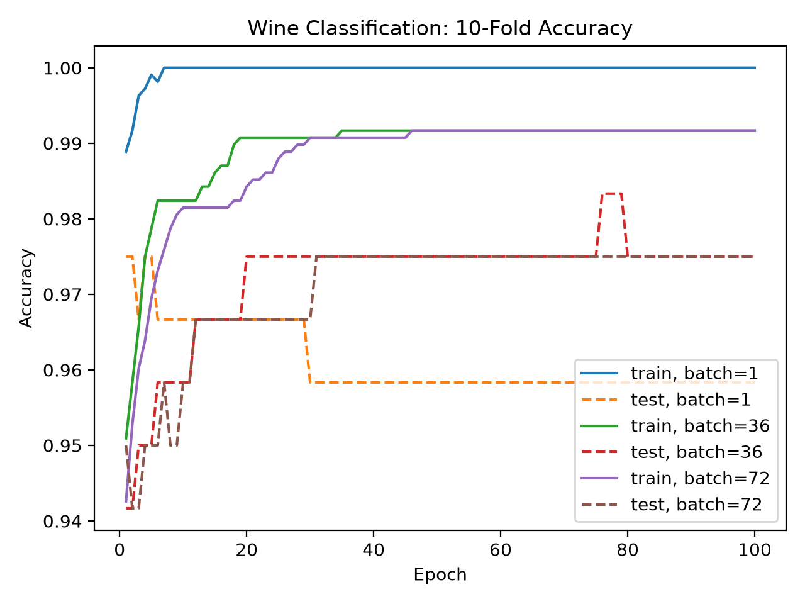
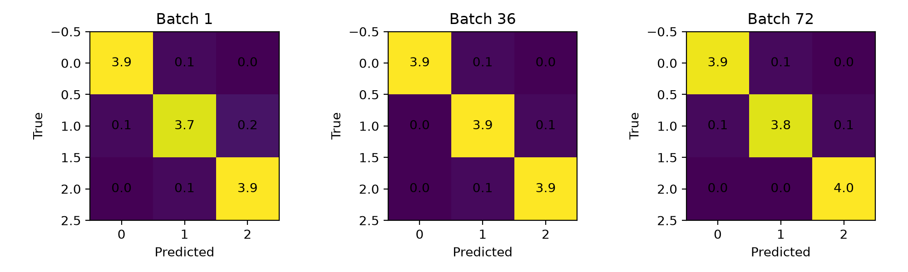

# Applied Machine Learning

A collection of regression and classification algorithms implemented with NumPy and tested on public datasets.

The goal of this project is to show how common machine-learning methods work by implementing the main training and prediction logic directly instead of relying on high-level model APIs.

## What This Project Includes

- Radius-based regression
- K-nearest-neighbor regression
- Polynomial regression using SVD
- Multivariate polynomial regression
- Softmax classification
- Mini-batch stochastic gradient descent
- Accuracy and confusion-matrix calculations
- K-fold cross-validation

The main algorithms are implemented with **NumPy**. Scikit-learn is used to load some of the public datasets.

## Datasets

- **California Housing** — uses median income to predict median house value
- **Auto MPG** — uses vehicle characteristics to predict fuel economy
- **Wine** — three-class classification using a softmax classifier

The datasets are not stored in the repository. The experiment scripts load them from scikit-learn or the UCI Machine Learning Repository.

## Results

For California Housing, the best radius-regression test MSE was about
**0.687**, while the best K-nearest-neighbor test MSE was about **0.691**.

For the Auto MPG dataset, the degree-1 multivariate polynomial model had
a test MSE of about **11.37**. Increasing the model to degree 2 improved
the test MSE to about **7.28**.

The degree-3 model lowered the training MSE to about **3.35**, but the
test MSE increased to about **571.72**, showing that the more complex
model was strongly overfitting the training data.

For the Wine classification experiment, the softmax classifier averaged:

- **95.8% test accuracy** with a batch size of 1
- **97.5% test accuracy** with a batch size of 36
- **97.5% test accuracy** with a batch size of 72

### Example Outputs





## Project Structure

```text
applied-machine-learning/
├── README.md
├── requirements.txt
├── .gitignore
├── src/
│   ├── __init__.py
│   └── ml_core.py
├── experiments/
│   ├── regression_experiments.py
│   └── classification_experiment.py
├── tests/
│   └── test_core.py
└── results/
    ├── wine_accuracy.png
    └── wine_confusion_matrices.png
```

## Run Locally

Create a virtual environment:

```powershell
py -m venv .venv
```

Install the dependencies:

```powershell
.\.venv\Scripts\python.exe -m pip install -r requirements.txt
```

Run the tests:

```powershell
.\.venv\Scripts\python.exe -m unittest discover -s tests
```

Run the regression experiments:

```powershell
.\.venv\Scripts\python.exe experiments\regression_experiments.py
```

Run the classification experiment:

```powershell
.\.venv\Scripts\python.exe experiments\classification_experiment.py
```

The experiment scripts save their plots in the `results/` folder.

The first California Housing or Auto MPG run may require internet access to download the datasets.

## Project Background

This project started from work completed in a graduate machine-learning course.

I later reorganized the code into reusable modules, improved parts of the neighbor-search logic, added additional checks to the SVD calculations, and updated the cross-validation preprocessing so each training fold calculates its own standardization values.

The repository is a cleaned portfolio version of that work rather than the original homework submission.
